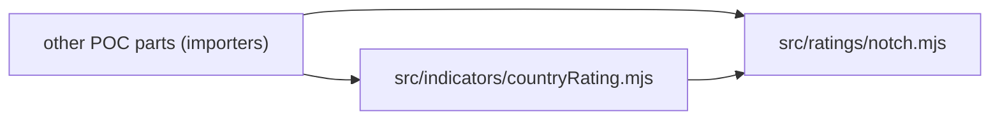

# Architecture Spine — rating-notch-helper

## Design Paradigm

Functional core: pure functions over plain values, no I/O, no state, no module-level mutable data. Two layers, dependencies point one way.

- `src/ratings/` — domain primitives: the rating scale, notch change, WL thresholds, validation.
- `src/indicators/` — POC indicator rules built on `ratings`.

## Invariants & Rules



### AD-1 — Import-only, pure, dependency-free [ADOPTED]

- **Binds:** all
- **Prevents:** a builder adding fetching, logging, files, env reads, UI or an npm package.
- **Rule:** `src/ratings` and `src/indicators` perform no I/O and import only `node:` built-ins or each other (`indicators` -> `ratings`, never the reverse). No npm dependency. No module-level mutable state; exported constants are frozen.

### AD-2 — One rating scale, one index lookup

- **Binds:** CAP-1, CAP-3, CAP-4
- **Prevents:** a second copy of the 19 ratings, or another rating-to-number mapping, drifting from the first.
- **Rule:** `RATING_SCALE` (frozen array, the 19 ratings AAA..CCC-, best first) in `src/ratings/notch.mjs` is the only source of rating order. Every notch number comes from `notchChange`; nothing else subtracts indices. Indicators and tests import `RATING_SCALE`, never retype it.

### AD-3 — WL thresholds live once; no profile argument (B-44/B-48)

- **Binds:** CAP-2, CAP-3
- **Prevents:** Ind. 12 re-implementing thresholds that differ from the calculator's; a profile parameter appearing on the public interface; importers guessing a different signature.
- **Rule:** The two threshold tables (`ind12`, `ind11-13`, per `notch-wl-tables.md`) are one frozen internal map in `notch.mjs`. The public interface is exactly `RATING_SCALE`, `notchChange(previous, current)`, `notchCalculator(previous, current)` -> `{ notches, direction, wl }` (`src/ratings/notch.mjs`) and `countryRatingChangeWl(previous, current)` -> `0 | 1 | 2` (`src/indicators/countryRating.mjs`, built on `notchChange`). `notchCalculator` takes no profile and applies the `ind11-13` rule (<=1 notch WL0, 2 WL1, 3+ WL2; B-57/B-60: REQ-06-02's example, 2 notches -> WL1, matches it); the profile selector is dropped entirely. `countryRatingChangeWl` obtains its WL through the `ind12` entry (an internal export of `notch.mjs`, not part of the public interface), never its own `if` ladder. Thresholds are not configurable. Supersedes the earlier required-profile rule (B-2/B-21).

### AD-4 — Sign and WL semantics

- **Binds:** CAP-1, CAP-2
- **Prevents:** callers and indicators disagreeing on direction or giving WL to upgrades.
- **Rule:** notches = index(current) − index(previous); positive is a downgrade. `direction` is `"downgrade"`, `"upgrade"` or `"unchanged"` from the sign of that number. WL > 0 only for downgrades; upgrade and unchanged give WL 0. `notchCalculator` (`ind11-13`): 1 notch gives WL0; `countryRatingChangeWl` (`ind12`): 1 notch gives WL1.

### AD-5 — Error contract by function, one validator (B-40, B-42/B-50)

- **Binds:** CAP-4
- **Prevents:** one function throwing where a sibling returns, differing messages, guessed numbers, lenient parsing.
- **Rule:** A single internal validator in `notch.mjs` trims the input and matches it case-insensitively against `RATING_SCALE` (`"bbb+"` = `"BBB+"`), then works on the canonical `RATING_SCALE` entry (only the 19 S&P/Fitch steps AAA..CCC- are accepted; per B-43/B-49). `"Aaa"` folds to `AAA` by the case-insensitive rule `[ASSUMPTION: C1 (B-58/B-61) does not name it]`; every other Moody's rating is rejected. Anything else (another notation such as Moody's, an outlook suffix, a Unicode minus, unrated, a non-string) is rejected. `notchCalculator` returns `{ error: <message> }` for any validation failure (its result is an object the form branches on) (no `notches`/`direction`/`wl` keys). `notchChange` and `countryRatingChangeWl` throw `RangeError` whose message names the offending input (previous or current, and the value); their return types are fixed (integer, `0|1|2`). A success result never contains `error`; an error result never contains `wl`. Programming-level failures are never swallowed.

### AD-6 — Test placement and checks [ADOPTED]

- **Binds:** all
- **Prevents:** untested scale pairs or boundaries; tests in a different layout.
- **Rule:** `node:test` + `node:assert/strict`; files `test/ratings/notch.test.mjs`, `test/indicators/countryRating.test.mjs`; `npm test` passes. Every ordered pair of the 19 ratings is checked against index arithmetic, every WL boundary of both tables (`ind11-13` via `notchCalculator`, `ind12` via `countryRatingChangeWl`), and each CAP-4 error case (including trim and case variants, and rejects: Moody's notation, outlook suffix, Unicode minus, unrated, non-string).

## Consistency Conventions

| Concern | Convention |
| --- | --- |
| Naming | ESM named exports only, no default export; camelCase functions, UPPER_SNAKE constants; files `.mjs` |
| Data & formats | Ratings are canonical `RATING_SCALE` strings (ASCII hyphen, e.g. `BBB-`); input is trimmed and case-insensitive, output always canonical; notches are signed integers; WL a number 0..2 here; direction a lowercase string |
| State & cross-cutting | No state, logging, config or env; errors per AD-5 |

## Stack

| Name | Version |
| --- | --- |
| Node.js (ESM, `node:test`) | 18+ (CLAUDE.md floor; dev machine runs 22.11.0) |
| npm dependencies | none |

## Structural Seed

```text
src/ratings/notch.mjs              # RATING_SCALE, notchChange, notchCalculator, WL threshold map, validator
src/indicators/countryRating.mjs   # countryRatingChangeWl
test/ratings/notch.test.mjs
test/indicators/countryRating.test.mjs
```

## Capability → Architecture Map

| Capability / Area | Lives in | Governed by |
| --- | --- | --- |
| CAP-1 notch change | `src/ratings/notch.mjs` | AD-2, AD-4 |
| CAP-2 WL (no profile) | `src/ratings/notch.mjs` | AD-3, AD-4 |
| CAP-3 Ind. 12 | `src/indicators/countryRating.mjs` | AD-1, AD-3, AD-5 |
| CAP-4 errors | `src/ratings/notch.mjs` (validator) | AD-5 |
| Tests | `test/` | AD-6 |

## Deferred

- Fetching ratings and their 12-month history (REQ-02-02 other half; C2 public sources only): a later fetcher part passes its values into this helper.
- Whether Moody's `Aaa` folds to `AAA` or is rejected (C1 does not name it; fold kept): business confirmation.
- Agency choice for the Other segment (Q2) and Moody's notation: Credit Policy.
- Ind. 11 and 13 indicator modules: they will call `notchCalculator(previous, current)` or add their own internal-map entry; not built here.
- Deployment, environments, operations, data store, security, observability: not applicable to an import-only library.
- README note on the helper API (DEL-docs default): at delivery.
