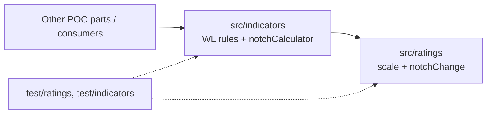

# Architecture Spine — rating-notch-helper

## Design Paradigm

Functional core, library-style. No process, no state, no I/O. Two layers; the dependency points one way.



- `src/ratings/`: the scale and notch difference. Knows nothing about WL or indicators.
- `src/indicators/`: WL thresholds per kind and the public entry point. Imports `src/ratings`; never the reverse.

## Invariants & Rules

### AD-1 — One scale, one threshold table, one owner each [ADOPTED]

- **Binds:** CAP-1, CAP-2
- **Prevents:** a second copy of the 21-notch scale or of the WL thresholds drifting from the first.
- **Rule:** the scale (incl. Moody's symbols mapped to the same positions) is a single frozen table in `src/ratings`; the WL thresholds are a single frozen table keyed by kind in `src/indicators`. No other file hardcodes a symbol, a position or a threshold. Thresholds are exactly those in the companion.

### AD-2 — Consumer contract: one entry point

- **Binds:** CAP-1, CAP-2, CAP-3
- **Prevents:** each POC part wrapping the scale and WL logic its own way.
- **Rule:** the public entry is `notchCalculator({ previous, current, kind })` exported from `src/indicators/notch-calculator.mjs`. The country rating change indicator (Ind. 12) is `kind: 'country'`; there is no second function. `src/ratings` exports `ratingPosition(symbol)` and `notchChange(previous, current)` for reuse; consumers import by file path (no barrel, no package entry).

### AD-3 — Result envelope; bad input never throws

- **Binds:** CAP-3
- **Prevents:** some callers handling exceptions and others handling result objects.
- **Rule:** success is `{ ok: true, notches, direction, wl }`; failure is `{ ok: false, error, field }` with `error` in `unknown_rating | missing_input | unknown_kind` and `field` in `previous | current | kind`. Bad input (null, wrong type, unknown symbol, NR/WR/SD/D) never throws and never yields a notch count or WL. Error results from `src/ratings` use the same shape, and `notchCalculator` passes them through unchanged.

### AD-4 — Sign and WL derivation

- **Binds:** CAP-1, CAP-2
- **Prevents:** inverted sign or per-kind rounding differences.
- **Rule:** `notches = position(current) - position(previous)` (downgrade positive, upgrade negative); `direction` is `'downgrade' | 'upgrade' | 'unchanged'`; `wl` is derived only from `d = max(notches, 0)` via the threshold table (AD-1). `wl` is an integer 0–2 here; combining WLs across indicators is out of scope.

### AD-5 — Input normalization lives in the ratings layer only

- **Binds:** CAP-3
- **Prevents:** indicators and consumers each trimming or casing symbols differently.
- **Rule:** `src/ratings` trims and upper-cases (Moody's notation matched case-insensitively) before lookup, accepts either notation in one call, and classifies null/undefined/non-string/blank as `missing_input` and any other non-matching string as `unknown_rating`. A missing or unknown `kind` is checked in `src/indicators`. When several fields are bad, the first is reported in the order `previous`, `current`, `kind`. [ASSUMPTION]

### AD-6 — Purity and no side effects

- **Binds:** all
- **Prevents:** logging, fetching, mutation of inputs or module state.
- **Rule:** `src/ratings` and `src/indicators` contain no I/O, no console output, no `Date`/randomness, no mutation of arguments, no module-level mutable state; tables are `Object.freeze`d. No UI, CLI, agency awareness or history lookup (spec non-goals).

## Consistency Conventions

| Concern | Convention |
| --- | --- |
| Naming | files `kebab-case.mjs`; functions `camelCase`; kind values lowercase strings `country`, `internal`, `external` |
| Data & formats | ratings are strings; notches and WL are integers; error codes snake_case as in AD-3 |
| State & cross-cutting | none: pure functions; no config, logging or auth |
| Tests | `node:test` + `node:assert/strict`; `test/ratings/<name>.test.mjs`, `test/indicators/<name>.test.mjs`; every companion worked example is a test; run with `npm test` |

## Stack

| Name | Version |
| --- | --- |
| Node.js (ES modules, `.mjs`) | 18+ (CLAUDE.md; 22.11.0 installed locally) |
| node:test, node:assert/strict | built in to Node 18+ |
| npm dependencies | none (CLAUDE.md forbids adding) |

## Structural Seed

```text
src/
  ratings/
    scale.mjs               # frozen scale table, ratingPosition
    notch-change.mjs        # notchChange(previous, current)
  indicators/
    wl-thresholds.mjs       # frozen thresholds per kind
    notch-calculator.mjs    # notchCalculator (public entry)
test/
  ratings/   indicators/
```

Environments and deployment: none. The module is imported in-process by other POC parts; there is no service, store, network call or runtime configuration. Rollback is a code revert.

## Capability → Architecture Map

| Capability / Area | Lives in | Governed by |
| --- | --- | --- |
| CAP-1 notch change, direction, WL | `src/ratings`, `src/indicators/notch-calculator.mjs` | AD-1, AD-2, AD-4 |
| CAP-2 country indicator (Ind. 12) | `notchCalculator` with `kind: 'country'` | AD-1, AD-2, AD-4 |
| CAP-3 error results | both layers | AD-3, AD-5 |
| Purity, no UI/I/O | both layers | AD-6 |

## Deferred

- Overall WL aggregation, WL override, indicator forms, segment/agency choice, rating fetching and 12-month history: other POC parts own them; they call `notchCalculator`.
- Packaging as an installable module, a barrel file, TypeScript types or JSDoc typedefs: not needed while consumers are in the same repo.
- Reporting all errors at once instead of the first: revisit if a consumer form needs it.
- Correction of REQ-06-02 in the POC document: follow-up for the document's owner, outside this job.
