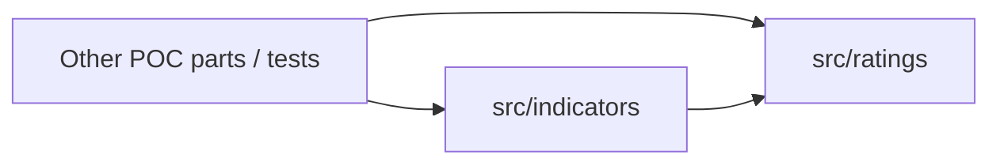

# Architecture Spine — rating-notch-helper

## Design Paradigm

Functional core: stateless, pure functions over plain data. No UI, CLI, API, database, network or file access; other POC parts import from `src/`.



| Layer | Path | Holds |
| --- | --- | --- |
| ratings | `src/ratings/` | `errors.mjs`, `scale.mjs`, `notch.mjs`, `watchlist.mjs` |
| indicators | `src/indicators/` | `countryRating.mjs` (Ind. 12) |

`src/ratings` imports nothing from `src/indicators`. Within `src/ratings`: `scale` and `watchlist` import only `errors`; `notch` imports `scale` and `watchlist`; `watchlist` never imports `notch`.

## Invariants & Rules

### AD-1 — Pure, dependency-free, no I/O
- **Binds:** all
- **Prevents:** a unit adding fetching, logging, clocks, randomness or an npm package
- **Rule:** `src/ratings` and `src/indicators` perform no I/O, read no clock or environment, keep no module state, have no `node:` imports in `src/`, never mutate or memoize a caller's `scale` or arguments, and add no npm dependency. The purity and layering tests check import specifiers only: they parse the `import` lines of each `src/` file and fail on any I/O module import (`node:` specifiers such as `node:fs`, `node:http`, `node:child_process`, or bare `fs`, `http`, `child_process`, `net`, `os`); no regex stripping of comments or string literals, and no scan of property names. [ADOPTED]

### AD-2 — The scale is data, injected
- **Binds:** CAP-1, CAP-3, CAP-4, CAP-5
- **Prevents:** notch logic hard-coding grade names; two builders each defining their own scale list
- **Rule:** A scale is an array of grade strings, best to worst; rank is its index. `RATING_SCALE` lives only in `scale.mjs`, is frozen, and is re-exported by name from `notch.mjs` (the 19 steps `AAA … CCC-`; CC, C, D are not in it and are rejected unless a scale holding them is injected; the 22-grade default of B-12 is withdrawn); the 19-step rule applies to this default only. Every function that needs ranks takes `scale` as an optional last argument; only `undefined` selects `RATING_SCALE`, any other value is validated. Rank is the 0-based index (the companion's 1–19 is only a reading aid). Notch change = `rank(current) − rank(previous)`. `rankOf` alone validates the scale: a non-array, empty, duplicate or non-canonical entry (canonical = already trimmed and upper-case, the form `rankOf` compares against) throws `INVALID_INPUT` with `value` = the scale. An injected scale that passes those rules is accepted as is: it may hold grades beyond the 19 (e.g. `CC`), need not be frozen, and is never mutated.

### AD-3 — One rating normaliser
- **Binds:** CAP-1, CAP-5
- **Prevents:** divergent trimming, case or character handling between callers
- **Rule:** Only `scale.mjs` turns caller input into a grade, via a single `rankOf(value, scale)`. It trims, upper-cases, and looks the result up by exact match in the scale. Non-string, or empty or whitespace-only after trim → `INVALID_INPUT`; any other miss (Moody's notation, outlook suffix, Unicode minus or en dash, `NR`, `CC`, `C`, `D`, unknown text) → `UNKNOWN_RATING`. No other module parses or compares rating strings. No guessing, defaults or fallbacks.

### AD-4 — Notch sign and direction
- **Binds:** CAP-1, CAP-3, CAP-4
- **Prevents:** one unit returning magnitudes while another returns signed values
- **Rule:** `notches` is always the signed integer (downgrade > 0, upgrade < 0, none = 0), in `notchChange` and `notchCalculator` (BB → BBB is −3). `countryRatingChangeWl` returns a WL, not notches. `direction` states the same sign in words: `'downgrade'` (n > 0), `'upgrade'` (n < 0) or `'unchanged'` (n = 0), derived only in `notch.mjs`.

### AD-5 — One WL table, no default indicator
- **Binds:** CAP-2, CAP-3, CAP-4
- **Prevents:** thresholds copied into indicator code; an implied default profile
- **Rule:** `watchlist.mjs` owns a single frozen table `WL_BY_INDICATOR` keyed by the numbers 11, 12 and 13, each with WL for n ≤ 0, 1, 2 and ≥ 3 (values in the companion, per REQ-03-11/12/13; Ind. 11 and 13 give WL 0 at n = 1 as an assumption). `wlFromNotches(indicator, notches)` is the only reader. Indicator must be one of 11, 12, 13 as a number, otherwise `UNKNOWN_INDICATOR`; there is no default. A policy change is an edit of this table only. `notches` must satisfy `Number.isInteger`, otherwise `INVALID_INPUT`. Results are the integers 0, 1 or 2.

### AD-6 — Orchestration lives in one place
- **Binds:** CAP-3, CAP-4
- **Prevents:** Ind. 12 re-implementing the calculation
- **Rule:** `notchCalculator(previous, current, options)` in `notch.mjs` is the only function that composes notch change, direction and WL, and returns the plain object `{notches, direction, wl}`. `options` is an object `{indicator, scale?}`; `options.indicator` (11, 12 or 13) is required and has no default: a missing, `null`, array or other non-object `options`, a missing `indicator` or any other value throws `UNKNOWN_INDICATOR` (`value` is the offending `options` or `indicator`, `undefined` when missing). [ADOPTED] `countryRatingChangeWl(previous, current, scale?)` in `countryRating.mjs` is built on `notchChange` and `wlFromNotches(12, …)`, returns 0, 1 or 2, and does nothing else. "Displayed" in REQ-06-02 is met by this return value; nothing prints. `notchCalculator` results are frozen plain objects (`Object.freeze`).

### AD-7 — One error type
- **Binds:** CAP-5
- **Prevents:** callers matching on message text, or builders throwing `TypeError`/`Error`
- **Rule:** `errors.mjs` exports `RatingError extends RangeError` with `name = 'RatingError'`, `code` ∈ {`UNKNOWN_RATING`, `INVALID_INPUT`, `UNKNOWN_INDICATOR`} and `value` (the offending input), and a message that names the value, built with a hand-written safe formatter (it must not throw on a Symbol or circular object). Every validation failure in the library throws it; nothing returns `null`, `NaN` or a sentinel. Callers branch on `code`. Validation of all arguments happens before any result is computed; with several faults the reported `code` is not contractual, and tests cover single-fault inputs only.

### AD-8 — Stable public surface
- **Binds:** CAP-1 … CAP-5
- **Prevents:** other POC parts importing internals, or two names for one thing drifting apart
- **Rule:** The public names are `RATING_SCALE`, `notchChange`, `notchCalculator` (`src/ratings/notch.mjs`), `wlFromNotches` (`watchlist.mjs`), `countryRatingChangeWl` (`src/indicators/countryRating.mjs`), `RatingError`; `wlFromNotches` and `RatingError` are importable public names. Signatures are positional: `notchChange(previous, current, scale?)` → integer, `notchCalculator(previous, current, options)` with `options.indicator` required → `{notches, direction, wl}`, `countryRatingChangeWl(previous, current, scale?)` → 0 | 1 | 2, `wlFromNotches(indicator, notches)`. Other POC parts import exactly these names and call `notchCalculator(previous, current, {indicator})`; a two-argument call throws `UNKNOWN_INDICATOR`; `notchHelper`, `countryRatingChange` and `DEFAULT_SCALE` do not exist. Named exports only, no default exports, no barrel file.

## Consistency Conventions

| Concern | Convention |
| --- | --- |
| Naming | camelCase functions, `UPPER_SNAKE` constants, file `<name>.mjs`, one concern per file as in the layer table |
| Data & formats | Ratings are strings in, never returned as other types; notches integers; WL integers 0–2; indicator the number 11, 12 or 13; `notchCalculator` results plain frozen objects |
| Errors | `RatingError` only (AD-7); no logging, no console output |
| Tests | `node:test` + `node:assert/strict`; `test/ratings/{scale,notch,watchlist,errors}.test.mjs`, `test/indicators/countryRating.test.mjs`; `npm test` runs `node --test` scoped to `test/**/*.test.mjs`, so worktree copies under `.work/` are not run; examples of the companion are the table-driven cases; `BBB+ → BB+` is not a passing test; the passing example is `BBB+ → BBB-` (2 notches, Ind. 11 WL 1); error cases assert `instanceof RangeError`, `code` and `value` |
| Test files | Test files are `*.test.mjs` under `test/` (the Ind. 12 file is `countryRating.test.mjs`, matching `countryRating.mjs`); helpers and fixtures live in `test/helpers/`, which `*.test.mjs` does not match; a layering test checks by import specifier that `src/ratings` never imports `src/indicators` |
| Required test rows | Beyond the companion's table: non-integer notches; indicator as string `'12'`; bad entries in an injected scale; injected scale containing `CC`; Ind. 11 at n ≥ 3 |
| Imports | Relative paths with the `.mjs` extension; dependency direction as in the diagram |

## Stack

| Name | Version |
| --- | --- |
| Node.js (ES modules, `node:test`, `describe`/`it`) | ≥ 18.6 (CLAUDE.md says 18+); no `engines` field; raising the floor is a project decision outside this job |
| npm dependencies | none |

## Structural Seed

```text
src/
  ratings/
    errors.mjs      # RatingError
    scale.mjs       # RATING_SCALE, rankOf
    watchlist.mjs   # WL_BY_INDICATOR, wlFromNotches
    notch.mjs       # RATING_SCALE (re-export), notchChange, notchCalculator
  indicators/
    countryRating.mjs   # Ind. 12
test/
  ratings/  indicators/
  helpers/        # shared helpers and fixtures, no *.test.mjs
```

Environment: none to provision. The library is consumed by import; no deployment, runtime service, feature flag, migration or rollback applies. `npm test` is the only gate; no CI configuration exists yet.

## Build Order

`errors.mjs` → `scale.mjs` → `watchlist.mjs` → `notch.mjs` → `countryRating.mjs`; each with its test file.

## Capability → Architecture Map

| Capability | Lives in | Governed by |
| --- | --- | --- |
| CAP-1 notch change | `src/ratings/notch.mjs`, `scale.mjs` | AD-2, AD-3, AD-4 |
| CAP-2 WL for indicator | `src/ratings/watchlist.mjs` | AD-5 |
| CAP-3 Ind. 12 | `src/indicators/countryRating.mjs` | AD-5, AD-6 |
| CAP-4 one-call helper | `src/ratings/notch.mjs` | AD-6, AD-8 |
| CAP-5 invalid input | `errors.mjs`, `scale.mjs`, `watchlist.mjs` | AD-3, AD-7 |

## Deferred

- Other indicators (1–10, and an Ind. 13 evaluator; only its WL thresholds are here, in AD-5), WL aggregation, override: other epics; they reuse `src/ratings` and add to `src/indicators`.
- Fetching or scraping ratings, source choice per segment (Q2): needs I/O and a source decision; stays outside these layers.
- Moody's notation, outlooks, `NR`/`WR`, `CC`/`C`/`D`: another scale can be injected through AD-2 when needed.
- 12-month date logic: caller supplies the earlier rating.
- UI, persistence, CI configuration, packaging/versioning: no consumer needs them yet.
- The exact 19 steps of `RATING_SCALE` are inferred from `AAA → CCC-` in REQ-03-10; Credit Policy to confirm.
- Credit Policy follow-ups (listed in the PR; nothing blocks delivery): build `BBB+ → BB+` as 3 notches, WL 2 as the spec states, Credit Policy confirms it and corrects the POC example; build WL 0 at exactly 1 notch for Ind. 11 and 13, the AD-5 table is the one place to change, Credit Policy confirms.
- Q2, the country rating source for the Other segment: follow-up for whoever supplies the ratings; out of scope.

## Delivery Checklist

NFR-performance, PRD-priority, PRD-users, NFR-privacy, NFR-audit, NFR-observability, NFR-compliance: none / not applicable. Reason: pure in-memory library, no data, no users, no I/O.

## Open Questions

None.
