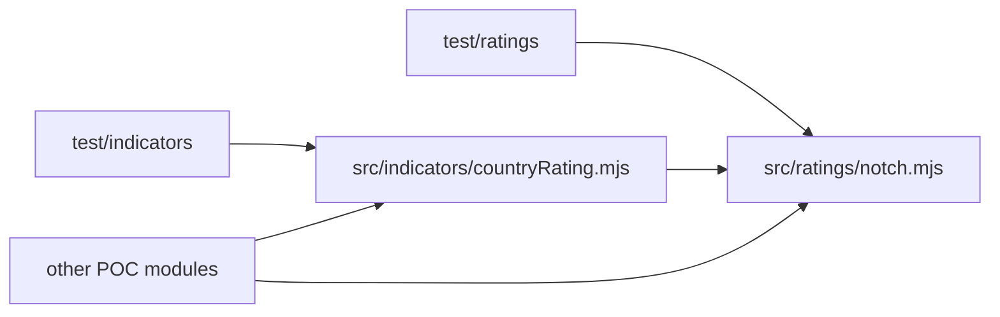

# Architecture Spine — rating notch calculator and country rating change

## Design Paradigm

A dependency-free library of pure functions in Node 18+ ESM. No UI, store, network or service. Two layers: `src/ratings` is the core (scale and distance), `src/indicators` sits on it (WL rules).



## Invariants & Rules

`[ADOPTED]` marks a decision taken over from the project's settled rules. Every AD is binding whether or not it carries the marker.

### AD-1 — `notchChange` is the single source of truth for distance

- **Binds:** CAP-1, CAP-2, CAP-3
- **Prevents:** Two modules each indexing the scale and disagreeing on sign or on what counts as a rating.
- **Rule:** Only `notch.mjs` looks up a rating's position. `notchCalculator` and `countryRatingChangeWl` obtain the distance by calling `notchChange`. Positive means downgrade, negative upgrade, 0 unchanged. `notchCalculator().notches` equals `notchChange` for the same inputs, and `direction` is derived from its sign.

### AD-2 — One scale, best first [ADOPTED]

- **Binds:** CAP-1
- **Prevents:** A second or wider scale (CC, C, D, SD, NR, Moody's) appearing in one module.
- **Rule:** `RATING_SCALE` is a frozen array of the 19 strings AAA, AA+, AA, AA-, A+, A, A-, BBB+, BBB, BBB-, BB+, BB, BB-, B+, B, B-, CCC+, CCC, CCC-. Array position is rank. Nothing outside `notch.mjs` redefines or copies it.

### AD-3 — WL mappings are named pure functions, kept apart per rule [ADOPTED]

- **Binds:** CAP-2, CAP-3
- **Prevents:** Thresholds inlined in several places; the Ind. 12 and Ind. 13 rules being merged or mixed up.
- **Rule:** Each rule is one small pure function from a signed notch count to a WL, with no scale logic. The calculator uses the Ind. 13 rule (unchanged, upgrade or 1-notch downgrade → 0; 2-notch downgrade → 1; 3 or more → 2). `countryRatingChangeWl` uses the Ind. 12 rule (1 → 1, ≥2 → 2). For both, upgrades and unchanged give 0 and only downgrades count. The two rules differ on a 1-notch downgrade on purpose: the calculator gives WL 0, Ind. 12 gives WL 1. Both helpers say so in a code comment. The calculator rule lives in `notch.mjs` and is not exported; the Ind. 12 rule lives in `countryRating.mjs`.

### AD-4 — Invalid rating: RangeError from `notchChange`, nothing else [ADOPTED]

- **Binds:** CAP-1, CAP-2, CAP-3
- **Prevents:** Mixed error behaviour (null here, `Error` there) and swallowed errors.
- **Rule:** The rating check runs after `trim()`. A non-string, empty or unknown rating, or one that differs in case, throws `RangeError` whose message names the offending value exactly as passed: `String(value)` for a non-string, the original untrimmed text for a string. When both arguments are invalid, the previous rating is validated first and is the one named. `notchCalculator` and `countryRatingChangeWl` let it propagate unchanged. No fallback, no null, no error object.

### AD-5 — Purity and import direction

- **Binds:** all
- **Prevents:** I/O or hidden state leaking into the core; circular imports.
- **Rule:** Modules in `src/ratings` and `src/indicators` do no I/O, read no clock or random source, keep no module state, and have no npm dependencies. `src/indicators` may import `src/ratings`; `src/ratings` never imports `src/indicators`. Exports are exactly those in the request's Contract.

### AD-6 — Test layout and the corrected example

- **Binds:** all
- **Prevents:** The wrong 2-notch example being encoded; tests scattered or needing a runner.
- **Rule:** Tests use `node:test` and `node:assert/strict` in `test/ratings/notch.test.mjs` and `test/indicators/countryRating.test.mjs`; `npm test` runs them. The REQ-06-02 example is BBB+ → BB+ = 3 notches, WL 2; the 2-notch case is BBB+ → BBB-, WL 1 (B-1, B-12). Tests cover every adjacent pair of the scale, each sign, and each invalid-input class from AD-4. Invalid-input tests assert the `RangeError` type and that the message contains the offending value, and pin exactly these non-string inputs: `null`, `undefined`, a number, `{}` and a `Symbol`. Exotic objects (null-prototype, throwing `toString`) are out of scope. Pinned cases: `' BBB+ '` is accepted; `'bbb+'`, `'   '` and `''` are rejected. Extreme distance: AAA → CCC- is 18 notches, calculator WL 2 and Ind. 12 WL 2. Also pinned: an unchanged rating gives notches 0, wl 0 and `direction` `"unchanged"`, with `Object.is(notches, 0)` so it is +0 not -0; a 1-notch upgrade; `RATING_SCALE` is frozen; and the calculator WL for a 2-notch downgrade beyond BBB+ → BBB- (AA → A+, WL 1).

## Consistency Conventions

| Concern | Convention |
| --- | --- |
| Naming | Files `camelCase.mjs`; named exports only, no default exports. |
| Data & formats | Ratings are plain strings; notch counts are integers; `direction` is one of `"downgrade"`, `"upgrade"`, `"unchanged"`; `wl` is 0, 1 or 2. |
| State & cross-cutting | No mutation of inputs or the scale; no logging or config; errors only per AD-4. |

## Stack

| Name | Version |
| --- | --- |
| Node.js | 18+ (ESM, `node:test`) |

## Structural Seed

```text
src/ratings/notch.mjs              # RATING_SCALE, notchChange, notchCalculator
src/indicators/countryRating.mjs   # countryRatingChangeWl
test/ratings/notch.test.mjs
test/indicators/countryRating.test.mjs
```

## Capability → Architecture Map

| Capability | Lives in | Governed by |
| --- | --- | --- |
| CAP-1 | `src/ratings/notch.mjs` | AD-1, AD-2, AD-4 |
| CAP-2 | `src/ratings/notch.mjs` | AD-1, AD-3, AD-4, AD-6 |
| CAP-3 | `src/indicators/countryRating.mjs` | AD-1, AD-3, AD-4, AD-5 |

## Deferred

- Ind. 11 and Ind. 13 WL functions: a later job. The later Ind. 13 job decides whether to reuse the calculator mapping and whether to export the helper (B-16); nothing is exported now.
- Follow-ups for the PR: the consuming form job owns "auto-filled value editable" (REQ-03-12); the consuming UI job needs a mapping step before calling, because Moody's-only sovereign ratings and sovereign ratings CC, C, D, SD and NR also throw `RangeError` and cannot be scored; the POC owner is asked to correct the REQ-06-02 example to BBB+ → BB+ = 3 notches / WL 2 (the POC text says 2 notches / WL 1); the PR states that the reviewer-gate lenses were skipped and only the deterministic lint ran (B-21, B-38), so `status: final` means the lint passed.
- UI and editable auto-fill, scraping, 12-month lookback, agency selector, final WL aggregation: out of scope per the SPEC.
- Deployment, environments, operations, security and performance: not applicable to a pure in-process library.
